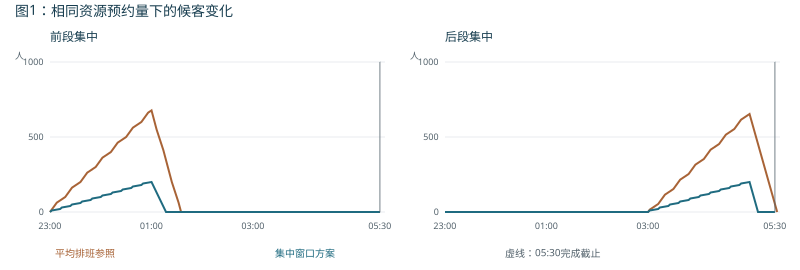

# 虹桥降雪晚点：五维划分的决策作用与调度对比

2026年10月12日｜真实事件记录与研究假设分别列示｜独立案例报告

## 1 真实事件与比较口径

### 事件事实及原处置结果

2023年12月14日，北方降雪导致部分列车晚点抵达虹桥火车站。上海市交通委员会公布了指令、交通保障措施和完成时点[1]。

| 事项 | 官方记录 |
|---|---|
| 信息及影响范围 | 21:28下发工作指令；23:00至次日05:00影响28班列车、10008名旅客 |
| 轨道交通 | 2号线延时至次日00:30，加开3班，运送273人次；根据铁路延误调整加班运力及检修安排 |
| 公交 | 316、320路夜宵线加密；23:00至次日05:00共20班，运送32人次 |
| 出租及现场组织 | 四大出租公司加强调度并派员驻点，配合广播、引导、执法及上客秩序维护 |
| 实际结果 | 出租车平均等待约5至15分钟，次日05:10疏散完毕 |

原处置已经实现多方式协同并完成疏运。报道没有公布实际响应等级、分时接续需求、全部排班或有效服务能力，不能据此断言原处理忽略了某项条件。10008人是受影响人数，不直接等于本研究的接续需求；也不能扣除地铁、公交人次后推算出租运量。

### 本报告的三种比较

| 比较对象 | 要检验的内容 | 可得结论 |
|---|---|---|
| 真实处置记录与五维情景描述 | 能否把措施、需求、时间和资源条件组织为可重复检查的记录 | 说明五维增加了哪些明确的决策依据；不评价原实际方案优劣 |
| 同一案例设定下逐项改变五维 | 哪一项变化会改变准备安排、保障档位或可行性 | 检验各维度在本模型中的区分作用 |
| 相同资源预约量下比较两种排班 | 平均铺开与按可能高峰安排，能否达到同一服务目标 | 检验时序匹配的模型内收益；平均排班是研究参照，不是当年原排班 |

**五维的价值首先体现在保障判断：同样叫“降雪晚点”，人数、进入节奏、准备时间和服务条件不同，所需保障可能不同。**具体调度还需结合资源承诺、设施限制和服务目标，不能由五个字段直接生成车辆指令。

## 2 五维情景描述及决策作用

### 每一维的含义与决策作用

| 维度及含义 | 事件证据与示范设置 | 决定的具体事项 |
|---|---|---|
| 信息提前量：可据以安排资源的决策时点，到首批旅客进入之间的时间 | 已知21:28下令；示范假设以此决策、首批23:00进入，相隔92分钟。首次消息与当时预测未知，92分钟不是核定的实际提前量 | 新增服务能否在首批进入前准备好；通知下发后，资源何时真正具备服务能力 |
| 到达不确定性：决策时需要共同覆盖哪些可能的进入过程 | 实际预测范围未知；示范设置均匀、前段集中、后段集中三种过程，不设置发生概率 | 事先排班需要防备哪些高峰；不能只用平均流量判断保障够用 |
| 旅客进入持续时间：同一新增群体从首批到末批进入多久 | 报道影响窗口为6小时；示范另假设研究群体在23:00至05:00进入。影响窗口不等于已核的候客输入期 | 服务需覆盖多久、末批何时进入，以及此后还需保留多久服务 |
| 新增待接续人数：确实需要本接续方案服务的新进入旅客数 | 实际10008人为受影响旅客；示范另设6000名符合地面接续边界的旅客，不按实际比例估计 | 本方案需要完成多大任务量；与初始候客和其他去向分别统计 |
| 方式与空间服务状态：各方式何时、何地、向哪些方向提供多少有效服务，并受哪些共用设施限制 | 轨道实际末端保留作背景；计算采用声明的地面服务能力、公交名额、登乘设施及上客限制 | 名义资源能否兑现；方向、时段或空间受限后是否需要调整保障 |

### 五维描述与保障分级的关系

五维用于描述运行条件。分级是在给定服务目标和参考资源后，找到能够同时满足要求的最低保障档位。前者回答“当前情景有什么特点”，后者回答“至少要准备哪档运力”。同一事件可以随运行条件变化形成多张情景卡。

群体方向、初始候客、服务目标、具体能力和资源生效条件仍须单独保存。五维是情景库的主字段，不是完整调度模型，也不表示五个字段独立就能确定等级。

## 3 计算对象、服务目标与参考资源

### 人群与三个可能过程

研究假设6000名旅客均能接受所列公交或出租接续；初始候客为0，按先到先服务，不设取消、安置或其他离场。完成是取得适配车辆并离开候客区，不是到达最终目的地。公交登乘采用连续过程近似，车辆返程和路网行驶不在本模型内。

| 可能过程 | 23:00至01:00 | 01:00至03:00 | 03:00至05:00 |
|---|---|---|---|
| 均匀进入 | 2000人 | 2000人 | 2000人 |
| 前段集中 | 4000人 | 1000人 | 1000人 |
| 后段集中 | 1000人 | 1000人 | 4000人 |

每段内按均匀速率进入。三种过程总人数、首末时点相同，仅进入节奏不同；它们是研究假设的检查集，不是三起事件或真实预测误差样本。同一个事先排班必须通过全部过程。

### 两个主目标与资源条件

主目标为候客人数不超过1000人；最后一批05:00进入后30分钟内全部完成，即05:30截止。个人最长等待作补充，不另设通过门槛。上述目标是示范设置，不是虹桥核定安全容量或实际承诺。

| 参考保障档位 | 可用服务及预约限制 |
|---|---|
| 现有保障 | 基础出租接续服务1200人/小时，05:00后继续；公交共20班，每班可兑现40人名额，共800人 |
| 加强保障 | 保留现有资源；新增出租服务最多250人/小时，总预约不超过1000人 |
| 联合保障 | 包含较低档方案；新增出租服务最多500人/小时，总预约不超过2000人 |

一处公交登乘设施同时只服务一班，每班登乘10分钟，相当于240人/小时；公交登乘及新增出租服务均须在05:00前结束。地面共用上客上限为2000人/小时。新增出租服务准备需要60分钟；基础服务及20班公交假设已可用，公交时刻可在设施允许范围内安排。

“联合”是本研究的参考资源档位，不按参与部门数量划分，不换算为原事件的行政响应等级。各项人数、能力、准备时长、名额和设施限制均为声明假设。

## 4 信息提前量与到达不确定性的决策作用

### 提前量决定服务何时能够兑现

基准设置在21:28决策，距首批进入有92分钟；新增出租服务需准备60分钟，因此22:28可就绪。若等到23:00才决策，同样资源最早00:00才可提供新增服务，基准排班23:00至00:00的500人增援服务量不能计入。

| 检查内容 | 提前92分钟 | 提前0分钟 |
|---|---|---|
| 新增出租服务最早就绪 | 22:28，首批前就绪 | 次日00:00，首批后1小时 |
| 基准计划首小时新增服务 | 500人可提供 | 不能提供，裁掉这段后复算 |
| 三种过程中的最大候客 | 200人 | 700人 |
| 三种过程中的个人最长等待 | 10分钟 | 35分钟，作为补充指标 |
| 最晚完成及主目标 | 05:10，全部通过 | 05:10，仍全部通过 |

**这一维改变了可兑现服务和候客峰值，即使保障档位没有改变，也必须更新排班的生效时间与结果。**资源数量充足还需满足到位时间；忽略准备时间，就会把700人的峰值误写成200人。本检查保留基准公交和后段安排，未把损失的预约量补到其他时段，不证明提前0分钟下的最优排班。

### 不确定性决定保障应覆盖哪些过程

| 判断所用的过程 | 其他条件 | 最低保障判断 |
|---|---|---|
| 仅检查均匀进入 | 6000人、6小时、同一组能力与目标 | 现有保障即可通过：平均每小时1000人，低于基础服务1200人/小时 |
| 同时检查均匀、前段和后段集中 | 总人数、持续时间、资源及目标均不变 | 需要联合保障：较低档在集中进入时不能完成要求，联合档有共同通过方案 |

这里比较的是两个研究信息条件，不是认定当年只按平均流量判断。它说明总量相同不代表保障需求相同。决策前若无法排除集中进入，应把相应过程纳入情景；已经知道实际过程之后再选择排班，不属于此处的事先保障。

## 5 进入持续时间与需求人数的决策作用

### 6000人进入期压缩时的能力限制

持续时间检查保留6000人和三种形状，将6小时进入期压缩为3小时；前后集中过程仍有三分之二的人在首或末三分之一时段进入。资源的物理服务窗口仍为23:00至05:00，末批后的完成时限仍为30分钟。

| 条件 | 基准：6小时进入 | 变化：3小时进入 |
|---|---|---|
| 首／末集中窗口 | 2小时内进入4000人 | 1小时内进入4000人 |
| 单位时间压力 | 集中窗口每小时2000人 | 集中窗口每小时4000人 |
| 参考联合档可提供的最大同时服务 | 基础1200＋新增500＋公交240，最多1940人/小时 | 同样最多1940人/小时 |
| 保障判断 | 有共同通过方案，最大候客200人 | 任意排班在集中一小时后至少候客2060人，超过1000人，参考资源均不足 |

2060人是允许能力的乐观上界所推出的最低积压：即使整整一小时始终按最高1940人/小时服务，也无法承接4000人的输入。这一结论排除了所列资源下的其他排班，不能通过仅更换公交时刻解决。须另设可用资源、改变服务条件或重新确定目标后再检查。

**进入持续时间决定压力压缩程度和保障维持时间。**只记总人数，会把6小时与3小时的情景混为一类；不确定性则说明在这个进入期内还需覆盖哪些不同节奏，二者分别记录。

### 需求人数决定任务规模及所需档位

| 新增待接续人数 | 其他条件 | 保障判断 |
|---|---|---|
| 3000人 | 均保持6小时、三种过程、基准能力及30分钟时限 | 现有保障即可通过 |
| 6000人 | 同上 | 需要联合保障 |
| 9000人 | 同上 | 参考资源均不足：前段两小时进入6000人，最高服务最多3880人，至少候客2120人 |

这组检查体现人数的决策作用，但3000、6000、9000不是拟定的普遍分级阈值。相同人数换用不同进入过程、能力或目标，结论仍可能变化；真实接续人数不能用受影响总人数代替。

## 6 方式与空间服务状态的决策作用

### 服务能力下降，基准联合档也可能不足

保留6000人、6小时及三种进入过程，仅把基础接续服务从1200降到900人/小时，其他资源和目标不变。

| 检查内容 | 基础1200人/小时 | 基础900人/小时 |
|---|---|---|
| 后段两小时新增旅客 | 4000人 | 4000人 |
| 联合档在该两小时最多服务 | 基础及增援3400人，加公交最多480人 | 基础及增援2800人，加公交最多480人 |
| 05:00后半小时最多服务 | 基础600人 | 基础450人 |
| 后段至05:30的乐观总能力 | 4480人，需进一步安排并检查 | 3730人，仍比4000人少270人，任何排班均不足 |

480人来自一处公交登乘设施连续两小时的最大服务量，不是20班公交的总800名额。可以给某个集中窗口连续安排更多班次，但不能突破同时登乘限制，也不能把同一批名额在两个时段重复计入。

基础降为900人/小时后，沿用第8节联合档排班，在后段集中过程05:53:20才完成，05:30仍有350人未完成。该排班的350人剩余是具体模拟结果；3730人的乐观能力界限则说明即使另排时刻，也至少差270人，二者用途不同。

### 运力不变，但上客空间收紧也会使方案失效

再单独检查共用上客上限从2000降为1500人/小时，基础服务保留1200人/小时，其余条件不变。后段两小时最多送走3000人；05:00后仅剩基础服务，半小时最多600人，共3600人，较4000人少400人。即使车辆供给仍足，所有已列档位也无法按时完成。

| 服务状态 | 基础条件下的判断 | 情景库须记录的具体变化 |
|---|---|---|
| 基础1200、上客上限2000人/小时 | 需要联合保障，有通过方案 | 记录方式能力、准备条件、服务窗口与设施限制 |
| 基础降为900人/小时 | 参考联合资源仍不足 | 服务能力下降，不沿用基准情景的保障档位 |
| 上客上限降为1500人/小时 | 参考联合资源仍不足 | 空间成为共同限制，不能继续叠加各方式名义能力 |

**这一维把“有车、有班次”转为“当前条件下真正能服务多少人”。**它既包括方式运行状态，也包括站位、登乘和共用上客限制。能力足够只是必要条件之一，仍要检查具体排班；能力上界都不足，则可直接排除该档位。

## 7 最低保障档位的判定

### 基准情景逐档检查

返回基准条件：提前92分钟、三种可能过程、6000人、6小时、基础1200人/小时及上客上限2000人/小时。候客上限1000人、末批后30分钟完成保持不变。

| 档位 | 所列集中窗口排班的最坏结果 | 两个主目标 |
|---|---|---|
| 现有保障 | 最大候客1200人，最晚06:00完成 | 均未满足 |
| 加强保障 | 最大候客700人，最晚05:35完成 | 人数通过，完成超时 |
| 联合保障 | 最大候客200人，最晚05:10完成 | 三种过程均满足 |

### 排除较低档的依据

现有档在前段两小时有4000人进入。即使基础服务连续承接2400人，公交连续登乘两小时承接480人，仍至少候客1120人，超过1000人。加强档在后段两小时最多承接基础及增援2900人、公交480人，再加05:00后的基础服务600人，共3980人，仍少于4000人。两项检查使用任意排班都不能超过的乐观能力界限。

联合档则有一个事先确定、三种过程均通过的具体排班。因此，在声明的参考资源边界内，可以判为“需要联合保障”。这包含两项证据：较低档均被排除，当前档存在可行方案。没有证明公交时刻的连续全局最优，也没有把这个档位认作实际行政响应等级。

### 五维划分在这里提供的优势

事件名称说明降雪晚点的原因；五维进一步保存影响保障的运行条件。分级结论能够对应具体失败原因：现有档卡在候客上限，加强档卡在完成时限，联合档通过。人数、进入节奏或服务条件更新后，可沿同一规则检查新的情景，避免只重复“加强协同”的笼统建议。

## 8 根据分级结果安排公交与出租服务

### 事先确定的时间安排

| 时段 | 安排 | 对应五维条件 |
|---|---|---|
| 21:28至22:28 | 确认需求方向、公交名额、出租分时承诺和上客条件，完成新增出租服务准备 | 提前量92分钟，准备需要60分钟 |
| 22:28至23:00 | 核实服务到位及首批进入信息；承诺未兑现则更新条件并重算 | 区分下令、承诺、到位与实际有效服务 |
| 23:00至01:00 | 基础1200人/小时 出租增援500人/小时 安排10班公交 | 覆盖可能的前段集中 |
| 01:00至03:00 | 保留基础服务，不预约此方案的额外服务 | 三种声明过程在中段输入较低 |
| 03:00至05:00 | 基础1200人/小时 出租增援500人/小时 安排另10班公交 | 覆盖可能的后段集中 |
| 05:00之后 | 基础服务继续处理剩余队列并核对原群体完成 | 最坏剩余200人，05:10完成，早于05:30截止 |

### 20班公交的具体时刻

前10班发车：23:12、23:24、23:36、23:48、00:00、00:12、00:24、00:36、00:48、01:00。后10班发车：03:12、03:24、03:36、03:48、04:00、04:12、04:24、04:36、04:48、05:00。每班发车前10分钟登乘，窗口不重叠。

20班共预约800个可兼容名额；两段出租增援各预约1000人服务量，总计2000人。公交登乘时总服务最高1940人/小时，低于共用上客上限2000人/小时。预约能力不等于实际全被使用，也不能据此推算出租车台数、车队周转或费用。

真实处置中的轨道延时、信息广播和现场引导保留为事实。数值安排仅针对声明的地面接续群体。三种过程以外的新高峰、方向变化或设施变化应更新情景后重算，不能直接沿用原通过结论。

## 9 相同资源下的排班与结果

### 对照所用资源与目标

平均排班参照同样预约20班公交、每班40名额，以及2000人出租增援服务量。公交23:18起每18分钟一班，最后05:00，每班登乘10分钟；增援在6小时内按每小时约333.3人铺开。集中窗口方案使用同样预约量，按第8节安排到前后两个可能高峰。两者基础服务、人群、进入过程、设施和目标相同，均在旅客进入前确定。

| 到达过程 | 平均排班参照 | 根据五维信息安排的方案 |
|---|---|---|
| 均匀进入 | 最大候客0人；05:00完成 最长等待0分钟；通过 | 最大候客0人；05:00完成 最长等待0分钟；通过 |
| 前段集中 | 最大候客677.3人；05:00完成 最长等待24分钟；通过 | 最大候客200人；05:00完成 最长等待10分钟；通过 |
| 后段集中 | 最大候客653.3人；05:32:40完成 最长等待32.7分钟；超时 | 最大候客200人；05:10完成 最长等待10分钟；通过 |

### 结果与机制

均匀进入时两种方案都通过；前段集中时最大候客减少477.3人；后段集中时完成提前22分40秒，并由超过截止变为达标。检查集中的最坏候客由677.3降到200人，约下降70.5%。本模型把人流作为连续量处理，小数人数用于比较计算结果，不表示实际可以服务零点几位旅客。

**收益来自相同预约服务量与可能高峰的时间匹配。五维提供这些条件，队列模型和排班检查负责得出结果。**不能将全部数值收益直接归因于“五个维度的数量”，也不能把平均排班参照认作原实际排班。相同名额与预约量不代表相同工时或费用，本例不作成本结论。

## 10 五维划分的优势及其证据

### 公开处置记录与研究情景的分工

| 比较方面 | 公开处置记录能够说明的内容 | 五维情景与分级给出的明确内容 |
|---|---|---|
| 事件与运行条件 | “降雪晚点”说明原因，10008人说明影响范围；原现场已根据延误调整保障 | 明确需要本方案服务的人数、进入过程及资源条件，区分同一事件中的不同运行情景 |
| 提前准备 | 真实记录有下令时点，未披露全部到位过程 | 核对决策、准备与生效时点，排除尚未就绪的服务 |
| 保障档位 | 报道列明地铁、公交、出租措施，但未公开实际量化触发规则 | 按同一目标逐档检验，说明哪项条件使较低档不足、当前档为何可行 |
| 具体安排 | 原实际排班不完整公开，真实保障已经成功 | 将声明资源落实为公交时刻和出租窗口，并核查同一方案是否覆盖全部允许过程 |
| 更新与复用 | 单次处置报道侧重采取了什么措施及结果 | 条件改变时按同一字段与规则重算，保留失败原因和适用范围，可用于其他符合边界的事件 |

仅按事件名称或总人数判断，是本报告设置的简化信息对照，不代表当年的决策方法。原现场可能已经考虑这些条件；五维的贡献是将影响保障的条件统一保存并逐项检验，形成可复用的情景结构。

### 五项优势对应的检查结果

信息提前量识别“资源能否及时兑现”：提前0分钟时原首小时增援不能生效，最大候客从200变为700人。到达不确定性识别“需防备哪些高峰”：同样6000人、6小时，仅均匀过程需要现有保障，纳入前后集中则需要联合保障。

进入持续时间识别“压力是否被压缩”：缩为3小时后，集中一小时至少候客2060人，所有参考档位均不足。新增待接续人数识别“任务规模变化”：3000人、6000人、9000人分别对应现有保障、联合保障与参考资源不足。

方式与空间服务状态识别“名义运力能否实际使用”：基础能力降低或共用上客限制收紧时，即使仍称为联合保障，也不能达到原目标。上述逐项变化说明五维具有具体区分作用；不是以事件名称、总人数或参与方式数量直接定级。

**可检验的优势是：分清不同保障情景，给出最低资源档位与失败原因，把资源安排到有效时段，并明确条件变化后何时需要重算。**现实疏运效果优于当年原处理不在本案例的证据结论内。

## 11 验证范围、适用条件与来源

### 需求与服务时限变化检查

| 示范需求 | 末批后15分钟完成 | 末批后30分钟完成 | 末批后45分钟完成 |
|---|---|---|---|
| 3000人 | 现有保障即可 | 现有保障即可 | 现有保障即可 |
| 6000人 | 需要联合保障 | 需要联合保障 | 需要加强保障 |
| 9000人 | 参考资源均不足 | 参考资源均不足 | 参考资源均不足 |

6000人且时限放宽至45分钟时，平均排班参照也能通过。因此，集中窗口方案的优势与既定目标、允许过程和服务条件有关，不是所有情景下始终更优。

验证共201次过程计算，其中180次覆盖资源、进入过程、需求和服务目标，21次检查信息提前量与进入持续时间变化；使用现行队列程序和另一套累计曲线实现，逐项核对峰值、完成时点、截止剩余和人数守恒。较低档能力界限、3小时输入压缩界限及空间上限界限分别排除任意排班。等待指标由现行先到先服务程序计算。独立实现是计算复核，不是新增真实事件样本。

本案例展示了事件资料整理、五维描述、目标与资源设定、逐档判级、排班、同资源比较及条件变化检查的过程。结论成立于声明的单一兼容群体、连续服务、给定资源与进入过程；不包括实际成功概率、车队费用、完整路网效果、五维唯一最优或虹桥真实阈值。真实事件实际05:10完成与模拟同一时点重合，不能认定为历史还原；实际平均等待与模拟最长等待也不能直接比较。

### 依据与复算

[1] 上海市交通委员会. 市交通委指挥中心全力做好虹桥火车站夜间大客流疏散交通保障工作. 页面署名2023年12月19日，事件为12月14日至15日。[官方处置记录](https://jtw.sh.gov.cn/xydt/20231226/6f4ed792491949fb871c7237e4d636ff.html)。2026年10月12日核对可检索正文；直接页面未稳定返回正文。仅据此使用处置及结果记录，不把实际运量解释为可用能力。

[验证程序](../06_实验验证/分级方法验证/verify_event_dispatch.py)生成[结果数据](../06_实验验证/分级方法验证/真实事件条件调度验证结果.json)。[现行队列程序](../06_实验验证/分级方法验证/grading_engine.py)与[独立累计实现](../06_实验验证/分级方法验证/independent_reference.py)采用不同计算实现核对。计算设定及关键结果已在本报告列明，链接用于复算。
