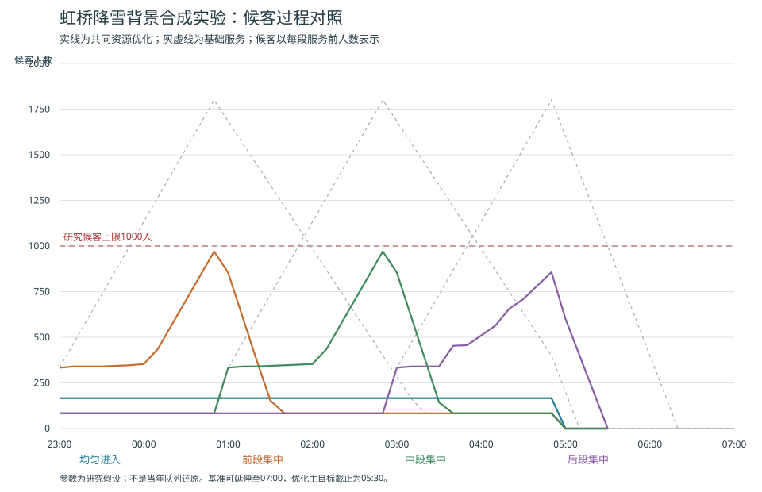

# 接续运输优化原型与虹桥事件背景实验

2026年10月19日｜已运行的参数化优化原型｜真实事件背景与合成参数分别列示

## 1　阶段成果：已经从方案进入计算

**已形成“完整情景卡输入—资源与服务优化—具体排班—独立复算—条件策略”的运行原型。当前可以计算，能够输出班次及名额，并能说明哪些条件使方案可行或不可行。**

| 成果 | 已完成内容 |
|---|---|
| 输入接口 | 一张扩充后的结构化模型卡，保存五维、方向、初始候客、资源、费用、舒适目标及证据属性 |
| 优化模型 | 混合整数线性规划；主实验2566个变量，其中225个整数变量、3398条初始约束 |
| 具体调度 | 6辆研究备用车安排19班公交，分方向预约1600个出租服务名额，附离站和再次可用时刻 |
| 条件实验 | 12组实验，检查不确定过程、预算、公交座位要求、站立负担、准备和共享设施等条件 |
| 独立核对 | 13项自动检查；小例穷举与优化一致；存档中29条过程独立重放并核对输入和代码版本 |
| 辅助案例 | 使用2023年虹桥降雪晚点的真实背景，逐项区分公开事实与研究参数，完成条件演示 |

主方案在24000元研究预算内，费用23980元；四种进入过程全部满足候客不超过1000人、05:30前完成的要求。候客峰值为970人，最坏平均等待约15.97分钟，公交站立负担不超过3000人分钟。

本原型的用途是研究城市接续方向、运力投入和时序安排。白天、夜间和跨日均可通过输入卡表达，本例选择夜间事件。完成口径为旅客获得兼容服务并离开规定候客系统；到接续节点的运行时间另报，不推算到家时间。

**以上是声明参数下的可复算结果。公开事实辅助核对研究对象和业务条件，数值实验检验模型的约束及决策逻辑；没有将本例写为当年处置的历史回放或实际收益测算。**

## 2　现实事件及其进入模型的方式

2023年12月14日北方降雪导致列车晚点抵达虹桥火车站。上海市交通委员会记录了保障指令、多方式措施与疏运结果。该事件同时涉及集中到达、末班附近服务、临时公交与出租协同，适合用作接续运输模型的业务背景。

| 公开事实 | 可用于本研究的内容 |
|---|---|
| 23:00至次日05:00影响28班列车、10008名旅客 | 确认事件及报道影响窗口；不能直接认定现场接续需求及曲线 |
| 2号线延时至00:30，加开3班，运送273人次 | 确认方式参与及时段；运送量不等于可供本任务使用的剩余容量 |
| 公交20班、运送32人次 | 确认有临时公交组织；20班不等于20辆车或800个实际需求名额 |
| 四大出租公司加强调度，次日05:10疏运完毕 | 确认联合保障与完成记录；不据此反推全部出租运量和成本 |

### 为检验方法而另设的参数

| 模型参数 | 本例声明值 |
|---|---|
| 固定任务与方向 | 新增6000人，初始0人；甲、乙、丙三个合成方向份额为50%、30%、20% |
| 四个允许过程 | 均匀、前段、中段、后段集中；总量均为6000人，不设置发生概率 |
| 时间与基础服务 | 假设23:00—05:00进入；基础接续1200人/小时；以10分钟为一段 |
| 公交 | 6辆备用车，最多20班，40座、核定容量60人，站立面积10平方米，单次上客10分钟 |
| 增援出租 | 每包10个服务名额，最多200包；每段最多8包；按预约计费 |
| 目标与费用 | 候客上限1000人，完成截止05:30；预算24000元；全部单价均为合成增量费用 |

报道中的10008人与研究设定6000人没有统计换算关系。三个方向、车辆、能力、准备、空间与费用均不是虹桥实测标定值。模型不为缺失的轨道剩余容量赋值，当前优化集中于地面公交和出租接续。

依据：[上海市交通委员会事件记录](https://jtw.sh.gov.cn/xydt/20231226/6f4ed792491949fb871c7237e4d636ff.html)，本轮重新核对；完整参数及属性见[模型输入卡](../03_情景库/模型输入卡-虹桥降雪背景.json)。

## 3　模型怎样把参数变成安排

模型先将每个可用方向、准备时点、公交运行和返回时间展开为候选任务，再决定选哪些任务、在哪些时段预约出租服务。所有允许过程共用同一份资源计划；旅客分配随已经观察到的需求变化，相同观测历史下必须采取相同分配。

### 计算的四类量

| 内容 | 模型处理方式 |
|---|---|
| 公交与出租安排 | 公交任务是否启用、出租服务包数量为整数决策；车辆和名额不任意拆成小数 |
| 实际服务与候客 | 分方向、分方式计算服务人数和候客；人数采用连续人流近似，允许小数 |
| 舒适与时间 | 约束站立密度、累计站立人分钟；计算实际等待、完成、候客密度及乘车耗时 |
| 目标与选择 | 先减少最坏累计等待，再在该等待水平下减少预约费用；固定资源后整理无必要的滞留与站立 |

### 必须同时满足的约束

人数守恒；不能服务尚未进入的旅客；分方向服务兼容；公交核定与舒适容量；准备与服务结束时点；同车周转和车队；共享站位；共享上客通过能力；下游节点的服务窗口和容量；候客安全上限；任务完成截止；预约预算；相同历史下的决策一致性。

舒适度采用文献支持的“拥挤状态与暴露时间”结构：从座位、站立人数、可站立面积和乘车时间计算。3000人分钟等数值是研究政策参数；没有将客观密度直接称为满意度，也没有直接移植其他城市的感知系数。基础及增援出租在本例中按有座服务假设，站立只计算公交。

主方案的首阶段相对求解差距约0.0994%，费用择优阶段差距为0。高预算实验有一组达到35秒时限，其可行方案仍通过独立核对，报告保留约0.188%的首阶段差距。

依据：舒适结构及核查范围见[研究方案第7—8节](../04_建模/情景库驱动的接续运输优化模型研究方案-v1.md)；[国内公交拥挤成本研究](https://xuebao.neu.edu.cn/natural/CN/10.12068/j.issn.1005-3026.2021.11.020)；求解接口与状态依据[SciPy官方说明](https://docs.scipy.org/doc/scipy-1.16.0/reference/generated/scipy.optimize.milp.html)。数学表达及时间约定见[模型说明](../04_建模/接续运输优化原型/README.md)。

## 4　主结果：同一预算上限下的条件比较

下表各列分别取四个过程的最坏值，最晚完成不一定与最大候客来自同一个过程。共同方案及两个对照采用相同的需求、目标、资源上限和舒适规则；平均方案与优化方案均受24000元预算上限约束，投入组成和实际费用不同。

| 策略 | 最大候客 | 最坏平均等待 | 最晚完成 |
|---|---|---|---|
| 仅基础服务 | 1800人 | 44.31分钟 | 06:20 |
| 平均预留资源 | 1049.33人 | 20.69分钟 | 05:50 |
| 共同资源优化 | 970人 | 15.97分钟 | 05:30 |

平均方案为20班公交、1470个出租名额，费用23940元；优化为19班、1600个名额，费用23980元。平均方案在中段集中时越过候客上限，在后段集中时05:30仍有约156.67人未完成；优化方案四条过程全部通过。四条合成过程不是统计样本成功率。

优化预约配合“只看当前候客、同方向先到先服务、基础优先”的简单执行器复算，仍在四种过程中全部通过，主要等待与峰值相符。因此，本例的结果可以落实为共同资源计划和明确执行规则，不必逐个未来过程另选一套排班。

**该比较展示了时序和资源组成调整的作用。平均方案是研究基准，没有取得当年原排班，不能称为优于当年真实处置。**

## 5　具体调度：车辆时刻可以逐项检查

本例19班公交全部服务合成方向甲，其客流较大、运行与返回较短、单班费用较低；乙、丙由基础及出租接续保障。该结果依赖本例参数。表内23时为12月14日，00—06时均为12月15日；每班登乘开始早于离站10分钟。

| 车辆 | 离站 | 到接续节点 | 可再投入 |
|---|---|---|---|
| 备用1 | 23:10 | 23:40 | 00:20 |
| 备用2 | 23:20 | 23:50 | 00:30 |
| 备用3 | 23:30 | 00:00 | 00:40 |
| 备用4 | 23:40 | 00:10 | 00:50 |
| 备用5 | 23:50 | 00:20 | 01:00 |
| 备用6 | 00:00 | 00:30 | 01:10 |
| 备用1 | 01:10 | 01:40 | 02:20 |
| 备用2 | 01:20 | 01:50 | 02:30 |
| 备用3 | 01:30 | 02:00 | 02:40 |
| 备用4 | 01:40 | 02:10 | 02:50 |
| 备用5 | 01:50 | 02:20 | 03:00 |
| 备用6 | 02:00 | 02:30 | 03:10 |
| 备用1 | 03:10 | 03:40 | 04:20 |
| 备用2 | 03:20 | 03:50 | 04:30 |
| 备用3 | 03:30 | 04:00 | 04:40 |
| 备用4 | 03:50 | 04:20 | 05:00 |
| 备用5 | 04:40 | 05:10 | 05:50 |
| 备用6 | 04:50 | 05:20 | 06:00 |
| 备用1 | 05:00 | 05:30 | 06:10 |

出租预约服务名额合计1600个，其中甲280、乙800、丙520。完整的10分钟预约表和登乘时刻分别见[出租预约](../05_协同调度/优化模型输出/出租预约.csv)与[公交排班](../05_协同调度/优化模型输出/公交排班.csv)。预约名额不等于车辆数，闲置预约仍计费。

## 6　预算与舒适要求怎样改变方案

| 预算／公交站立上限 | 取得的费用 | 最坏平均等待 | 当前结论 |
|---|---|---|---|
| 18000元／3000人分钟 | — | — | 当前候选集合不可行 |
| 24000元／3000人分钟 | 23980元 | 15.97分钟 | 四过程通过 |
| 30000元／3000人分钟 | 28400元 | 13.62分钟 | 限时可行方案，首阶段差距约0.188% |
| 24000元／0人分钟 | — | — | 公交全员有座政策下不可行 |
| 30000元／0人分钟 | 28400元 | 15.48分钟 | 公交无站立、四过程通过 |
| 24000元／12000人分钟 | 24000元 | 15.29分钟 | 实际最坏站立负担为5400人分钟 |

另外以费用为首要目标求解，在原3000人分钟站立约束下，当前候选集合的最低可行预约费用为23300元，费用求解差距为0；该方案最坏平均等待约18.71分钟。它与23980元的等待优先方案说明：最低费用和最短等待可能对应不同安排。

### 本例能够支持的策略判断

增加预算可以换取更短等待，也可用于满足更严格的公交座位要求。放宽站立负担可以降低等待，但需要同时保留核定容量和站立密度限制。预算提高并不要求全部花完；高预算实验取得的方案使用28400元。

参考包实验也使用本模型新目标版本：无出租增援、最多1000个增援名额且每小时最多240人，以及最多2000名额且每小时最多480人。前两包不可行，后一包已有共同可行方案。它们是本例的研究资源包，不是政府响应等级。

**这里的元、分钟和站立人分钟各有含义，结果以方案取舍呈现。所有费用均采用合成单价，23300元等数字不能认定为虹桥实际预算或普遍分级阈值。**

## 7　验证结果与策略适用边界

### 已完成的检验

13项自动检查覆盖：穷举小例、无预算、缺失容量、人数口径不一致、准备晚于窗口、零需求、相同历史的决策一致、同车冲突、未来服务、站立与密度、下游关闭、共享通过能力以及初始候客。

可手工核对的小例共有12人，每10分钟进入2人，两班6座公交在第30、60分钟离站，累计等待为240人分钟；穷举与优化一致。存档复核另外重放21条可行优化过程及8条对照过程，检查代码和输入哈希、人数、车辆、站位、下游、舒适和完成条件。

| 边界检查 | 结果及含义 |
|---|---|
| 无提前信息 | 公交与新增出租均需60分钟准备；本离散批量时序下首段候客越限，当前问题不可行 |
| 共享上客降为1500人/小时 | 后段集中4000人；后两小时最多服务3000人，随后半小时基础服务最多600人，总量仍不足 |
| 未参与优化的混合过程 | 在同一预约与当前队列执行器下通过，峰值约603.33人，平均等待约14.23分钟 |
| 未参与优化的末小时6000人 | 不能通过，峰值4680人，截止仍有3810人未完成，说明原策略不覆盖该极端过程 |

### 结论按证据范围解释

段初批量进入、段末服务完成是明确的离散模型；一分钟事件核对仍沿用同一约定，没有获得一分钟实际需求，也不证明连续真实客流的精度。无提前信息的临界时点尤其依赖该时间约定。车辆登乘占用、返回和服务窗口已建模，逐人装载速度与行人移动尚未细化。

当前可证明的是代码与声明模型一致、小例目标正确，以及所列情景下方案及失效原因可复查。集合外过程同时保留通过和失败，未用它们调参后再称独立检验。真实事件只提供业务与证据背景，没有将合成结果作为实际处置改善率。

依据：[自动检查与结果](../06_实验验证/优化模型验证/README.md)、[全量实验及求解状态](../06_实验验证/优化模型验证/优化实验结果.json)。

## 8　下一阶段与三人分工

### 现阶段可以直接使用什么

已有结构化输入卡、运行程序、数学与参数说明、求解状态、独立核对、预算／舒适实验、公交与出租具体表以及候客图。三人可以基于同一套文件复现、解释和修改，无需重新搭建一个只有文字的框架。

### 按顺序扩展

先完成一轮团队复现和口径评审；再选一项扩展，例如更细时间步、运行时间扰动或不同接受方式的人群，保持其他条件不变。之后再加入执行中车辆位置与不可撤销任务，研究滚动调整。感知舒适函数和常态公交调出代价按文献及数据条件另行进入；当前物理站立负担不冒充主观满意度。

| 成员 | 主要负责 | 首轮交付 |
|---|---|---|
| 万岩松 | 模型统筹、运行与解释，统一参数及版本 | 完整复现记录；讲清输入、目标、约束和排班为何可行 |
| 梅玉坤 | 指标与数学口径，舒适、等待及成本依据 | 指标和参数出处；核对文献定义与代码计算是否一致 |
| 张子凡 | 事件证据、参数属性和实验图表 | 事实／假设对照；复查案例窗口、统计人群与比较条件 |

该表为建议分工，未登记成员已经完成的人工复核。细分任务及交叉复核见[三人分工](../项目管理/模型阶段三人分工-2026-10-19.md)。

**当前已完成一个可运行、可检查的小规模研究原型。下一步围绕输入覆盖、时间精度和动态调整扩展，并用统一情景和指标判断扩展是否有实际研究收益。**

依据：技术入口为[优化模型](../04_建模/接续运输优化原型/README.md)，输出入口为[调度表与曲线](../05_协同调度/优化模型输出/README.md)；文献及方法选择见[研究方案](../04_建模/情景库驱动的接续运输优化模型研究方案-v1.md)。
