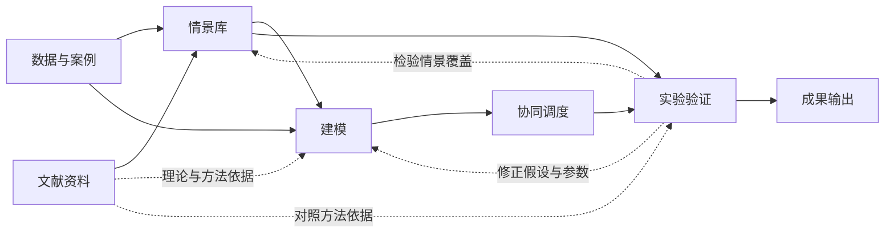

# 虹桥枢纽应急协同调度研究

课题：突发事件下超大规模交通枢纽多方式协同联动策略。

**给老师展示：**打开[情景库思路演示](07_成果输出/情景库思路演示.html)，载入“预测开始窗口5—30分钟”，点击“计算当前事件评定”。准备需20分钟时，主提示按最早5分钟给二级，同时保留二、三级范围；人数与候客压力另列。再改一个参数、重新计算，或展示六组成对检查。可保存新版本、复制、比较和导入导出；真实报道原型的未知参数保留为空。单文件可离线打开，本机平台首页同样提供，完整工作台位于 `/research`。

**当前重点（2026年10月25日）：先描绘和评定事件，再研究交通处理。** [事件评定原型02](03_情景库/事件描绘与紧迫程度评估原型.md)已实现底板/时段引用、逐项证据、开始时间区间、缺参时保留已知危险或超限、修改后隐藏旧结果，以及本地版本库。四档是研究提示，未映射官方预警或响应。首次信息提前量与当前剩余时间分开，进入节奏与预测不确定性分开。下列材料按各自阶段保留。

**当前研究定位（2026年10月21日）：情景库建模与事件评估为主要研究内容。** 枢纽相对稳定条件、常态时段规律和事件扰动分层组织，形成可复用的参数情景及评估输入。既有预案、论文指标与调度方法提供处置参照；前期自拟“现有／加强／联合”档位属于历史方法试验，不作为当前的正式事件等级或主要创新点。

平台第一步已调整为事件条件评估，报告候客峰值、占所设上限的比例、完成时间和截止剩余，并可引用已有预案或论文方法。[研究方案](04_建模/情景库驱动的接续运输优化模型研究方案-v1.md)说明研究贡献与应用验证的关系；[使用说明](04_建模/交互验证平台/README.md)说明当前功能。展示页已采用有限底板/时段注册表及版本化情景；完整网络工作台仍保存自身完整输入，尚未迁移，也未自动接收新评定卡。

**2026年10月20日平台实现记录：**双击[启动研究平台](启动研究平台.cmd)，在本机浏览器先通过主要参数预判保障档位，再配置任意方式、节点、线路、资源池、旅客去向和服务日历，优化或核对手工安排。[平台使用说明](04_建模/交互验证平台/README.md)与[通用网络模型](04_建模/多方式网络优化/README.md)说明完整流程。快速预判完成12项专门检查及36组独立累计核对，网络模型完成24项通用性与约束检查，并用四种不同结构的卡调用同一求解器；虹桥作为一张真实背景例证。数据和运行记录保存在本机，不自动同步到GitHub。

**2026年10月19日研究推进：**已从情景库扩展出[可运行的接续运输优化模型](04_建模/接续运输优化原型/README.md)，接通情景卡、资源安排、具体排班与独立复算。已完成12组条件实验及13项自动检查。虹桥降雪事件背景实验在声明参数下，用6辆备用车安排19班、预约1600个出租服务名额，费用23980元，四种进入过程均满足候客上限与05:30完成要求。[8页结果报告](07_成果输出/接续运输优化原型与虹桥事件背景实验-2026-10-19.pdf)汇总比较、验证及边界；[研究方案](04_建模/情景库驱动的接续运输优化模型研究方案-v1.md)保留文献依据与扩展路线。数值为合成参数实验，不表示历史处置改善率。

前期情景库方法探索形成**五维情景组织结构与目标约束下的保障层次分级方法**。已完成关键词定义、研究边界、五维选择及口径论证、32张合成检查卡和4张真实材料卡。新增五组受控例证及72组组合的252对比较，支持信息提前量、到达不确定性、旅客进入持续时间、新增待接续人数、方式与空间服务状态各有区分作用；同五维异初始积压反例明确必须保留附属细节。汇报正文采用中文字段，汇报二以十项研究比较、逐维定义、受控检验和建库方法论证五维可行性。真实事件模拟与处置对比见[独立案例报告](07_成果输出/真实事件模拟与对比-虹桥降雪晚点.pdf)，完成声明假设下的分级调度、逐维决策检查、同资源比较和201次过程核算。理论、独立核算、边界与目标敏感性为计算支撑。研究覆盖白天、夜间与跨日，等级表达“需要哪档运力保障”，候客上限与完成时限为主条件，个人等待为补充。结论不包括五维独立充分、唯一最优或虹桥真实阈值已校准。

先读[文件一：关键词与边界](07_成果输出/导师汇报一-关键词解释与研究边界-2026-10-12.md)和[文件二：五维依据与可行性](07_成果输出/导师汇报二-情景库五维划分依据与可行性-2026-10-12.md)，核心依据见[五维划分可行性论证](03_情景库/五维划分可行性论证-v1.md)及[五维验证结果](06_实验验证/分级方法验证/五维划分验证结果.json)，计算支撑见[成立条件与证明](03_情景库/分级方法成立条件与理论验证-v1.md)及[完整验证说明](06_实验验证/分级方法验证/方法完整验证说明.md)。真实材料用于核对象、约束与边界；运营后台接入、实际标准核定及现场试用属于成果应用条件，不作为本阶段研究未完成项。公开来源台账保留；已被替代的报告可从Git历史追溯。

本仓库按课题的研究模块组织：文献和案例提供依据，情景库定义研究场景，建模表达供需与约束，协同调度形成策略，实验验证比较效果，成果输出汇总最终作品。任务安排和过程记录集中放在项目管理中。

## 课题完成流程



## 项目结构

```text
jiaokesai/
├─ 01_文献资料/       政策预案、分级标准、学术文献与研究综述
├─ 02_数据与案例/     真实事件、客流与运力数据、参数口径
├─ 03_情景库/         情景维度、危害约束、分级判据与情景生成
├─ 04_建模/           需求积压、运力能力、到位时间、变量与约束
├─ 05_协同调度/       多方式策略、联动权限、资源配置与求解
├─ 06_实验验证/       对照方案、情景实验、敏感性分析与结果评价
├─ 07_成果输出/       作品说明书、研究报告、图表及答辩材料
├─ 项目管理/          分工、排期、导师意见、评审与修订记录
└─ 历史归档/          WorkBuddy原稿、仓库初始文件及校验记录
```

## 模块入口与当前进展

| 模块 | 输入与研究内容 | 向下一模块提供 | 当前进展 |
|---|---|---|---|
| [文献资料](01_文献资料/README.md) | 政策、预案、标准及已有方法 | 研究边界、指标依据、方法对照 | 8篇情景方法对照、11篇代表综述及关键文献补核；清单存在重叠，部分全文待取得 |
| [数据与案例](02_数据与案例/README.md) | 事件记录、客流、服务能力、方向与时间 | 情景参数、模型输入、检验样本 | 两轮24条公开来源审查、4事件缺口登记；校正12线拓扑/日期，实际参数不以报道替代 |
| [情景库](03_情景库/README.md) | 运营冲击、危害信息与需求能力条件 | 可追溯的情景定义及生成规则 | RULE-02与LIB-INIT-02；32张合成检查卡、4张真实材料卡，按已列方案条件判级 |
| [建模](04_建模/README.md) | 情景、需求、能力及到位时间 | 数学关系、目标、约束与参数接口 | 已实现混合整数优化原型，共同资源计划、舒适与成本约束及求解状态可复查 |
| [协同调度](05_协同调度/README.md) | 模型、资源与权限条件 | 各方式准备、动员与疏运策略 | 已输出具体公交车辆排班、出租预约及曲线；保留历史分级示范，条件与版本分别解释 |
| [实验验证](06_实验验证/README.md) | 情景集、策略及独立事件 | 效果比较、稳健性与适用边界 | 新模型12组条件实验、13项自动检查、29条存档过程独立复算；既有分级验证另记 |
| [成果输出](07_成果输出/README.md) | 各模块研究材料与确认状态 | 阶段报告、后续说明书和答辩材料 | 新增8页模型结果报告；两份情景库汇报、独立案例、串讲稿与研究方案按用途保留 |

## 当前优先阅读

- [交互验证平台与完整使用流程](04_建模/交互验证平台/README.md)：可视录入、模型生成安排、手工排班复算、候客明细、运行历史及完整验证包。
- [优化原型结果报告](07_成果输出/接续运输优化原型与虹桥事件背景实验-2026-10-19.md)：已完成内容、事件背景、调度表、策略比较、预算舒适取舍及验证边界。
- [运行原型说明](04_建模/接续运输优化原型/README.md)与[模型阶段三人分工](项目管理/模型阶段三人分工-2026-10-19.md)：运行、数学口径、参数及建议交付。
- [接续运输优化模型研究方案](04_建模/情景库驱动的接续运输优化模型研究方案-v1.md)：导师沟通后的建模设计、文献比较、输入输出及实施路线。
- [文件一：关键词、边界与文献选择](07_成果输出/导师汇报一-关键词解释与研究边界-2026-10-12.md)和[文件二：五维依据与可行性](07_成果输出/导师汇报二-情景库五维划分依据与可行性-2026-10-12.md)
- [五维论证](03_情景库/五维划分可行性论证-v1.md)、[初始情景库](03_情景库/初始情景库-v2.md)与[五维验证结果](06_实验验证/分级方法验证/五维划分验证结果.json)
- [理论成立条件](03_情景库/分级方法成立条件与理论验证-v1.md)与[完整验证说明](06_实验验证/分级方法验证/方法完整验证说明.md)
- [公开缺口核实](02_数据与案例/公开数据缺口核实-2026-10-11.md)、[缺参结论](03_情景库/缺参情景判级与可行性结论-v1.md)与[约束验证](06_实验验证/分级方法验证/公开证据约束验证说明-v1.md)
- [课题关键词界定表](01_文献资料/课题关键词界定表.md)与[研究综述](01_文献资料/研究综述-T-C3.md)
- [数据字典](04_建模/数据字典与方法框架-v1.md)与[协同动作接口](05_协同调度/情景到协同动作接口-v1.md)
- [分工方案](项目管理/国庆七天三人分工方案-优化版.md)与[修订记录](项目管理/复查与修订记录.md)

其他依据和过程材料从各模块README进入。成果输出包括两份研究汇报及对应PDF、独立事件案例、汇报串讲稿、建模方案和说明文件，旧版由Git历史保存。

2026年10月1—7日排期作为历史计划保留。当前已按规则、依据、初始库、适用性检查顺序完成阶段整理，并自主完成所列公开资料核验。缺少实际目标与资源时交付参数化门槛和X-DATA，不以团队或导师补数作为本轮收尾条件；新公开证据满足口径后再升级真实卡。

## 研究版本说明

原稿Λ公式及1/3/8阈值停止采用；到达人数、滞留人数和运输人次分别记录。F0-F3为用户选定用途下的研究内部参考保障层，仅在已列方案、目标、方向及共享约束下解释，尚未成为虹桥实际分级标准。T-A3、T-A6、T-B和T-C继续按分工推进，团队评审与人工复核状态如实记录。

当前展示使用[文件一PDF](07_成果输出/导师汇报一-关键词解释与研究边界-2026-10-12.pdf)与[文件二PDF](07_成果输出/导师汇报二-情景库五维划分依据与可行性-2026-10-12.pdf)。公开补证为辅助依据；取得2022总体预案全文，后续适用版及专项仍按证据状态记录。

当前修订文本采用Markdown，原始Word保留在历史归档。工作区10月10日Word转换稿尚未通过逐页版式检查，且未包含本次收尾修改。引用、假设、未完成条件及修改依据见[复查与修订记录](项目管理/复查与修订记录.md)。
