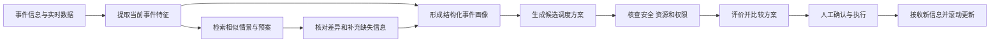

# zzf10.28归纳的思路方案

整理人：张子凡（zzf）。整理日期：2026年10月28日。用途：团队讨论的研究思路，算法选型、评价指标与最终分工待团队和导师讨论确认。

## 一、总体思路

项目围绕突发事件下超大规模交通枢纽的旅客接续疏运，构建“情景识别与检索—应急方案生成与评价”两个相互衔接的模块。第一模块描绘当前事件并组织相关证据；第二模块根据事件画像和可用资源生成、比较候选方案。两个模块通过统一的数据接口连接，随事件信息更新进行滚动调整。

示例研究问题：晚点列车夜间集中抵达虹桥时，在给定疏运窗口和安全条件下，如何协调地铁、公交和出租车，安排资源、发车时刻与服务方向，满足旅客接续需求。

## 二、模块一：情景识别、检索与事件画像

模块一接收文本描述、人工填报和可用运营数据，提取事件类型、影响时间、人群、交通方式及安全条件，再从历史情景和适用预案中检索相关信息，形成当前事件画像。

1. **特征提取**：从当前事件资料中识别已有信息，标注来源、采集或预测时点与数据质量。
2. **高级检索**：按事件类型、影响对象、时段、空间、方式可用性等条件检索相似案例和相关预案，展示相似点、差异及出处。
3. **信息补全**：根据当前已知条件与案例经验，提示需要调查的字段，例如地铁末班、公交储备、道路状态和出租车到位情况；缺失值保持未知。
4. **生成画像**：将经确认的数据、预测区间和缺失项整理为统一格式，提供给决策模块。

历史案例用于提示信息和候选措施。当前事件的参数应来自本次观测、预测或明确标注的研究假设；历史值不能直接当成本次资源承诺。检索相似度是方法输出，不能直接解释为事件发生概率。

## 三、模块间数据接口

| 字段组 | 主要内容 | 输出要求 |
|---|---|---|
| 事件与危害 | 事件类型、发生地点、危险和安全限制 | 标注已确认或待核，安全限制优先传递 |
| 旅客需求 | 需接续人群、分时到达曲线或区间、去向和特殊需求 | 区分到达量、滞留量和运输人次；写明时间窗与空间边界 |
| 交通服务 | 各方式线路、时段、剩余有效能力、可新增服务 | 区分已确认资源、预测资源和待确认资源 |
| 时空条件 | 出口、上客点、道路、场站容量及资源到位时间 | 保留方向、共享资源及可达性限制 |
| 信息状态 | 数据来源、采集时刻、预测区间、缺失项 | 信息变化时保留版本；缺失值不自动填零 |
| 规则与权限 | 适用预案、审批主体、资源确认和终止条件 | 区分历史动作、方案建议与已授权动作 |

画像只是决策输入。方案计算完成后，必须依据实时信息确认资源、责任人及生效时间；研究系统输出供人工决策使用。

## 四、模块二：应急决策与方案优化

### 4.1 决策内容

在给定事件画像和服务网络下，确定交通方式组合、各方向的资源分配、公交投入及发车时刻、轨交加班安排、出租车预约名额和必要的备用方案。输出应包含行动对象、数量、时刻、地点、适用条件、数据依据和待确认事项。

当旅客到达或资源状态发生变化时，更新画像并重新计算；执行中的既定安排、准备时间和资源周转应计入后续计算。

### 4.2 算法路线

| 方法 | 可承担的工作 | 适用条件 |
|---|---|---|
| 数学优化 | 根据给定需求、运力和约束计算车辆、班次、路线和服务分配 | 目标、约束、资源与需求口径可明确 |
| 深度学习 | 预测分时客流、到达时间或其他输入 | 有足够数量、质量和覆盖范围的训练数据，并评估预测误差 |
| 强化学习 | 在变化的信息和状态下学习分阶段调整策略 | 有经过检验的仿真环境、训练情景以及安全约束处理机制 |
| 混合方法 | 预测需求及不确定区间，再由优化模型生成方案；或结合学习与约束检查 | 明确接口、误差传播及约束兑现方式 |

建议先以项目现有的数学优化原型建立可复现基线，再根据数据和仿真条件决定是否增加深度学习或强化学习。算法名称本身不构成创新；研究价值需通过与相关研究及基准方案的比较说明。

## 五、如何衡量“最合理”

先满足安全、可用性、能力和权限等硬约束，再比较服务效果和资源代价。若多个目标冲突，按团队确认的优先顺序或权衡方式比较，也可以输出多个备选方案。

| 层次 | 指标或条件 | 示例 |
|---|---|---|
| 可执行底线 | 安全容量、道路与方式可用性、资源数量及到位时间、授权 | 不安排车辆进入已封闭道路；不重复占用同一车辆 |
| 核心疏运效果 | 未完成疏运人数、候客峰值、完成时间、平均等待及长等待情况 | 比较同一时间窗、同一人群下的改善 |
| 资源和服务代价 | 车辆投入、费用、对常态服务的影响 | 固定费用口径，明确是否包含既有服务成本 |
| 公平与可达 | 不同方向、特殊需求人群的等待和服务覆盖 | 避免总体平均改善掩盖局部群体长等待 |
| 应对变化 | 输入扰动下的可行性、结果变化和重新计算时间 | 检查到达偏差、资源延迟及道路受限情形 |

指标的计算窗口、单位、对象和权重需要在实验前确定。团队可考虑优先满足安全，再减少未疏运人数和等待，最后比较资源代价；具体次序须由团队确认。

## 六、验证设计

1. **统一条件**：相同事件人群、时间窗、资源、道路和安全约束；明确相同或不同的信息获取时点。
2. **设置基准**：选择可复现的固定顺序、经验规则或其他明确方案，与当前优化模型比较。
3. **检验两个模块的作用**：比较使用与不使用检索补充信息时的画像完整性、关键差异识别和方案表现；检查检索结果是否真正改变决策。
4. **压力与扰动测试**：改变到达节奏、可用运力、到位时间和通行状态，检查安全约束、方案效果和计算时间。
5. **留出情景或事件**：将未参与规则、参数选择及模型调试的情景留作测试；按事件划分，避免同一事件的不同报道重复计为独立样本。
6. **报告范围**：分别记录真实事件事实、合成输入、模型结果和现场验证状态；给出不可行、缺参和求解超时等情况。

## 七、与现有成果的衔接

| 已有成果 | 在本方案中的作用 | 下一步接口 |
|---|---|---|
| [10月27日情景检索演示](../07_成果输出/演示版本/2026-10-27-情景检索协同决策/README.md) | 展示事件录入、相似案例、补充观测及决策单 | 完善字段来源、版本、相似度解释与验证 |
| [情景生成方法](../03_情景库/情景生成方法方案-T-A6.md)及现有情景库 | 提供案例、约束、原型与情景组织依据 | 对齐当前事件画像字段并维护案例身份 |
| [多方式网络优化模型](../04_建模/多方式网络优化/README.md) | 作为候选方案生成与对照基线 | 核实画像到网络输入的映射与实际资源条件 |
| [交互验证平台](../04_建模/交互验证平台/README.md) | 提供事件评估与网络工作台 | 研究两模块的数据传递、版本和人工确认流程 |
| [案例台账](../02_数据与案例/案例与来源台账-T-C4初稿.md) | 支持真实背景、来源和数据质量核验 | 增补分时需求、服务能力与独立事件资料 |

现有演示相似度采用演示加权规则；既有模型实验包含合成参数。完整网络工作台尚未自动接收新评定卡。以上系统与结果应按各自实现范围使用，后续通过接口联通。

## 八、建议推进顺序与待确认问题

1. 确定研究范围与一个代表性决策问题，统一人群、时间窗、目的地和完成定义。
2. 整理事件画像字段与数据字典，建立来源、更新时间、区间及缺失状态。
3. 将已有案例检索和现有优化模型通过统一输入卡衔接，展示从画像到方案的完整链路。
4. 确定安全约束、核心指标和基准方案，完成同条件实验及扰动测试。
5. 依据数据和验证结果，评估引入预测模型或强化学习的必要性、可行性与预期贡献。

待团队和导师确认：情景库的主要创新问题、研究对象边界、指标优先级、基准方案、可获取数据和算法扩展范围。本文件为zzf的思路归纳，不代表团队已经完成决策或新增实现。
